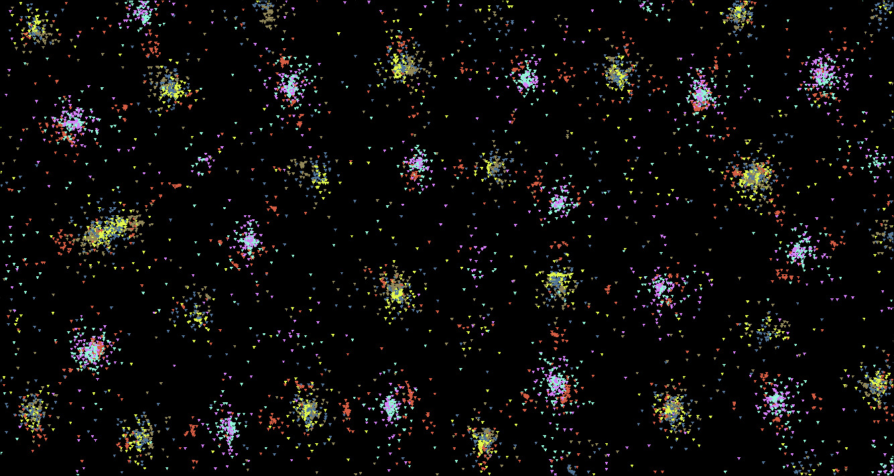
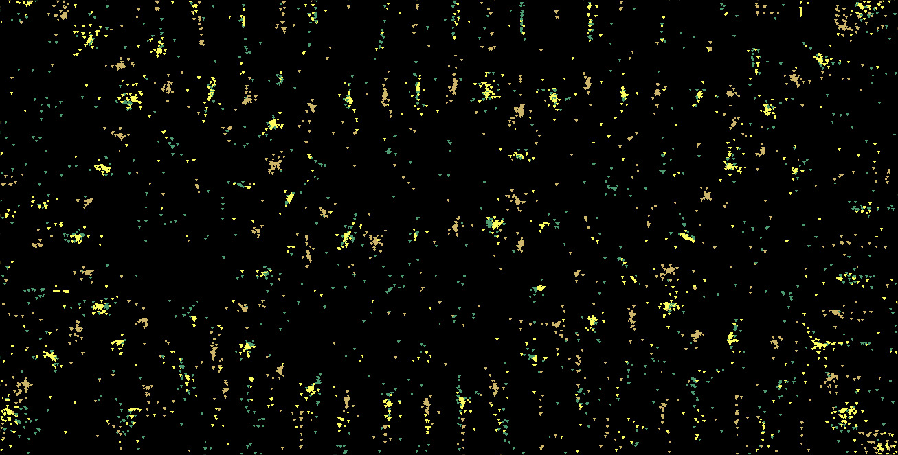

# Particle Life

This project is a C++ implementation of a "Particle Life" simulation, a type of artificial life simulation where particles interact with each other based on a set of simple rules.

## What is Particle Life?

Particle Life is a simulation that demonstrates how complex, life-like behaviors can emerge from simple interactions between a large number of particles. Each particle has a "type," and the interactions between particles are determined by the types of the two interacting particles. These interactions are governed by a set of attraction/repulsion forces.

## Emergent Behavior

The fascinating aspect of this simulation is the emergent behavior that arises from the simple rules of interaction. You can observe behaviors such as:

*   **Swarming:** Particles of the same or different types grouping together and moving as a cohesive unit.
*   **Predator-Prey Dynamics:** One type of particle "chasing" another.
*   **Orbiting:** Particles or groups of particles orbiting each other.
*   **Complex Structures:** The formation of intricate and stable patterns.

## Showcase


### Videos

[Link to a video of your particle life simulation]

### Photos




## Implementation

The simulation is built in C++ using the SFML library for graphics and windowing.

The core of the simulation is in the `Particles` class. Each particle has a position, velocity, and a "type." The interaction forces between particles are calculated in the `update` method. The force between two particles is a function of the distance between them and their types.

## How to Compile and Run

This project uses a `Makefile` for compilation.

### Compile

To compile the project in release mode:

```bash
make release
```

To compile the project in debug mode:

```bash
make debug
```

This will create an executable named `particle_life` (for release) or `particle_life_debug` (for debug).

### Run

The executable currently expects two command-line arguments: `numParticles` and `numParticleTypes`. The `drag` and `speed` parameters are not set via command-line arguments and will default to `0.0f` at startup. You will need to adjust them using the keyboard commands after the simulation begins.

Example:

```bash
./particle_life 1000 5
```

Where:
*   `1000`: Number of particles
*   `5`: Number of particle types

After launching, use the `[` and `]` keys to adjust the speed, and `;` and `'` keys to adjust the drag.

## Keyboard Commands

| Key         | Action                                 |
| ----------- | -------------------------------------- |
| `Escape`    | Close the window and exit the program. |
| `R`         | Reset the simulation with new random particle types and positions. |
| `[`         | Decrease the simulation speed.         |
| `]`         | Increase the simulation speed.         |
| `;`         | Decrease the drag coefficient.         |
| `'`         | Increase the drag coefficient.         |
| `,`         | Decrease the interaction range (cutoff). |
| `.`         | Increase the interaction range (cutoff). |
| `C`         | Toggle "clear screen" mode (formerly `isClean`), which clears the screen on each frame. |
| `Mouse Click`| Reset the simulation. |

## TODO

- [ ] Implement different types of functions to calculate the force between particles.
- [ ] Add keyboard commands to cycle through different boundary handling modes (e.g., Bounce, Pass, Curve).
- [ ] Add keyboard commands to change the shape of the particles (e.g., from Triangle to Point).
- [ ] Add ability to define and use more particle shapes.
- [ ] Add keyboard commands to change the radius of particles.
- [ ] Implement a feature to take screenshots and record videos of the simulation.
- [ ] Improve velocity normalization to prevent particles from reaching excessively high speeds.

